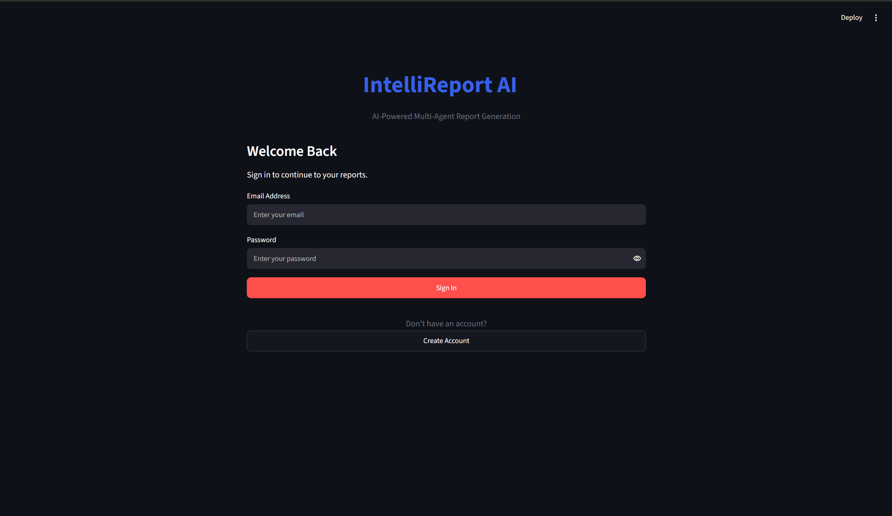
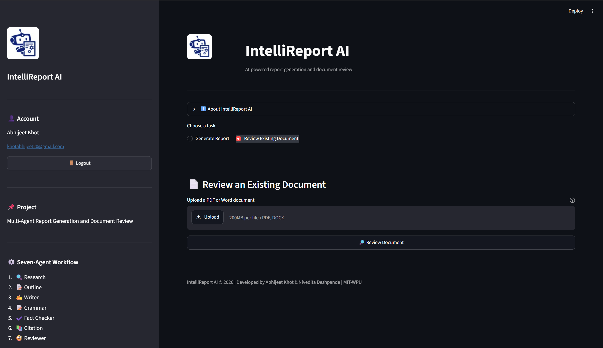
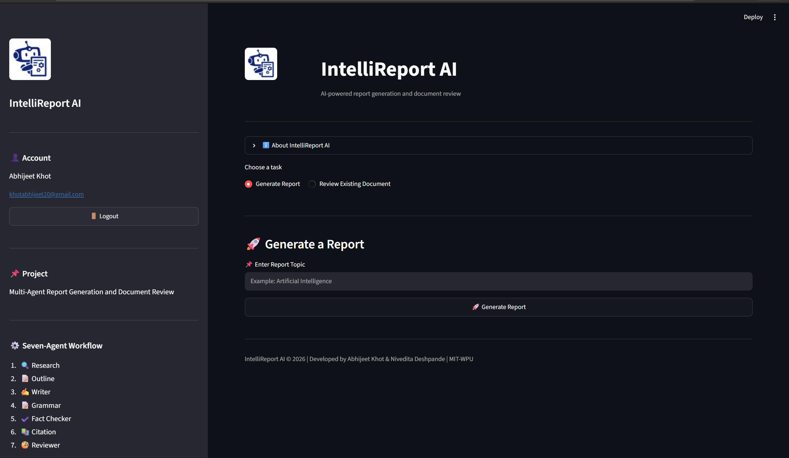
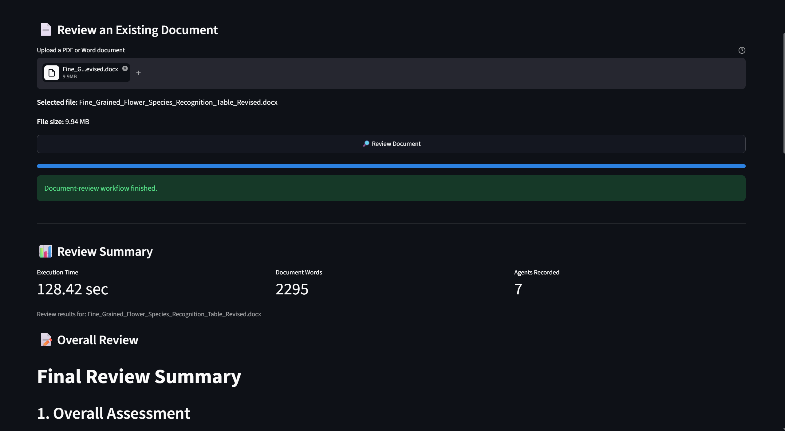
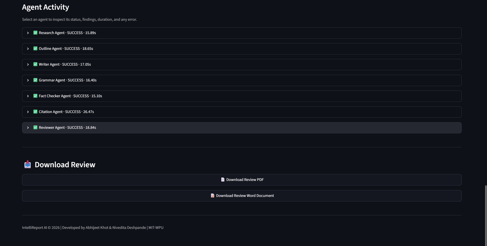

# 🤖 IntelliReport AI

> **Production-Style Multi-Agent AI Report Generation and Document Review System**

🚀 **Live Demo:** [IntelliReport AI](https://intellireport-ai-jgxptgtt7yup22giykkjae.streamlit.app/)

IntelliReport AI is a Streamlit application that uses Google's Gemini AI and LangGraph to coordinate a seven-agent workflow for researching, outlining, writing, improving, checking, citing, and reviewing reports. It also supports AI-assisted review of existing PDF and Word documents.

The application includes user authentication, SQLite-based report storage, analytics, and downloadable PDF and Word outputs.

---

## 📸 Application Screenshots

### Login and Authentication


### Main Dashboard — Document Review


### Main Dashboard — Report Generation


### Document Review Results


### Agent Activity and Download Options


> Screenshots show the application interface and example workflow output. Avoid including real credentials, API keys, or sensitive document content in screenshots.

---

## 📌 Project Overview

IntelliReport AI divides report generation into multiple specialized stages rather than relying on a single prompt. The LangGraph workflow coordinates the agents and assembles the final report.

The current application supports two main tasks:

- **Generate Report** — create a structured report from a user-provided topic.
- **Review Existing Document** — upload a PDF or Word document for AI-assisted review and download the review output.

Authenticated users can access their own stored reports. The application also provides execution information and agent activity for supported workflows.

## 🚀 Features

- 🔍 AI-powered research stage
- 📝 Automatic report outline generation
- ✍️ Report writing
- 📝 Grammar and language improvement
- ✔️ AI-assisted fact-checking stage
- 📚 Citation generation
- 🧐 Report review
- 📄 Review of uploaded PDF and DOCX documents
- 📊 Workflow analytics and agent activity
- 📥 PDF export
- 📝 Microsoft Word (`.docx`) export
- 🔐 User registration and login
- 🔑 Password hashing and verification
- 👤 User session management and logout
- 🗄️ SQLite database for user and report records
- 🔒 User-specific report access
- 🧪 Automated tests for authentication, database, document review, exports, and integration
- ⚙️ Local performance benchmarks for selected document-processing and export operations
- 🎨 Streamlit user interface
- 🤖 Google Gemini AI integration
- 🔄 LangGraph multi-agent workflow

**Important:** AI-generated claims and citations may be incorrect. The fact-checking stage should not be treated as definitive independent verification, and citations should be checked against their original sources.

---

## 🧠 Seven-Agent Report Generation Workflow

The report-generation workflow contains these agents:

1. **Research Agent** — prepares research content for the requested topic.
2. **Outline Agent** — organizes the report structure.
3. **Writer Agent** — drafts report content.
4. **Grammar Agent** — improves language and readability.
5. **Fact Checker Agent** — reviews factual claims.
6. **Citation Agent** — generates citation content.
7. **Reviewer Agent** — reviews the resulting report.

The workflow assembles the final report and supports saving and exporting the result.

```text
User Topic
    |
    v
Research Agent
    |
    v
Outline Agent
    |
    v
Writer Agent
    |
    v
Grammar Agent
    |
    v
Fact Checker Agent
    |
    v
Citation Agent
    |
    v
Reviewer Agent
    |
    v
Final Report
    |
    +----> SQLite report storage
    |
    +----> PDF / DOCX export
```

The existing-document review workflow is separate from the report-generation workflow and processes an uploaded PDF or DOCX document through the document-review pipeline.

---

## 🔐 Authentication and Security

IntelliReport AI provides account creation, login, logout, and protected application access.

The authentication implementation includes:

- PBKDF2-HMAC-SHA256 password hashing
- Random password salts
- Password verification
- Case-normalized email handling
- User ownership checks for stored reports

Passwords should not be stored as plain text. Keep API keys and other secrets out of source control.

## 🗄️ Database

The application uses SQLite for local persistence. The database is created at:

```text
data/intellireport.db
```

The database includes user and report records.

### `users`

| Field | Description |
|---|---|
| `id` | Unique user ID |
| `name` | User name |
| `email` | Unique email address |
| `password_hash` | Hashed password |
| `created_at` | Account creation time |

### `reports`

| Field | Description |
|---|---|
| `id` | Unique report ID |
| `user_id` | User who owns the report |
| `topic` | Report topic |
| `report` | Generated report content |
| `review` | Reviewer feedback |
| `created_at` | Report creation time |
| `execution_time` | Workflow execution time |
| `word_count` | Report word count |

The local database and generated output files should not be committed to GitHub. On hosting platforms with ephemeral filesystems, local SQLite data may not persist through restarts or redeployments; use a suitable persistent database if durable cloud storage is required.

---

## 🛠 Technology Stack

| Technology | Purpose |
|---|---|
| Python | Application programming language |
| Streamlit | Web application interface |
| LangGraph | Multi-agent workflow orchestration |
| LangChain | LLM integration |
| Google Gemini AI | Language model |
| SQLite | Local user and report persistence |
| PBKDF2-HMAC-SHA256 | Password hashing |
| ReportLab | PDF generation |
| `python-docx` | Word document export |
| Pillow | Image processing |
| `python-dotenv` | Local environment variable loading |
| Git and GitHub | Version control |

---

## 📂 Project Structure

```text
IntelliReport-AI/
├── agents/
│   ├── research_agent.py
│   ├── outline_agent.py
│   ├── writer_agent.py
│   ├── grammar_agent.py
│   ├── fact_checker_agent.py
│   ├── citation_agent.py
│   └── reviewer_agent.py
├── auth/
├── database/
├── graph/
│   ├── workflow.py
│   └── state.py
├── ui/
├── utils/
│   ├── llm.py
│   ├── export_pdf.py
│   └── export_docx.py
├── tests/
│   ├── test_auth.py
│   ├── test_auth_ui.py
│   ├── test_database.py
│   ├── test_document_review.py
│   ├── test_exports.py
│   └── test_integration.py
├── performance/
│   └── benchmark.py
├── test_results/
│   ├── environment.txt
│   └── performance_results.csv
├── screenshots/
│   ├── login.png
│   ├── homepage01.png
│   ├── homepage02.png
│   ├── output01.png
│   └── output02.png
├── assets/
│   └── logo.jpg
├── app.py
├── requirements.txt
├── TESTING_AND_PERFORMANCE.md
└── README.md
```

This is a high-level view; individual files may vary as the project evolves. Local configuration files, virtual environments, databases, and generated outputs should remain excluded from version control where appropriate.

---

## ⚙️ Installation

### Prerequisites

- Python installed on your system
- A Google Gemini API key
- Git

### 1. Clone the repository

```bash
git clone https://github.com/Abhijeet01khot/IntelliReport-AI.git
cd IntelliReport-AI
```

### 2. Create and activate a virtual environment

**Windows PowerShell:**

```powershell
python -m venv venv
.\venv\Scripts\Activate.ps1
```

### 3. Install dependencies

```powershell
pip install -r requirements.txt
```

### 4. Configure your Gemini API key

For local development, create a `.env` file in the project root if the application configuration uses `python-dotenv`:

```env
GOOGLE_API_KEY=YOUR_GEMINI_API_KEY
```

Replace the placeholder with your own key. Confirm that this variable name matches the one read by the application's LLM configuration.

**Never commit `.env`, API keys, passwords, or other secrets to GitHub.** For a hosted deployment, configure secrets through the hosting platform rather than hardcoding credentials.

---

## ▶️ Run the Application

From the project root with the virtual environment activated:

```powershell
python -m streamlit run app.py
```

Open the local URL printed in the terminal, usually:

```text
http://localhost:8501
```

## 🔑 First-Time Login

1. Open the application.
2. Select the create-account option.
3. Enter your name, email address, and password.
4. Sign in using the account you created.
5. Choose **Generate Report** or **Review Existing Document**.
6. Log out when finished.

Follow the password requirements shown by the application.

---

## 🧪 Testing

The project includes automated tests for database operations, authentication, document review, exports, and integration paths.

Run the test modules from the project root:

```powershell
python -m tests.test_database
python -m tests.test_auth
python -m tests.test_auth_ui
python -m tests.test_document_review
python -m tests.test_exports
python -m tests.test_integration
```

Run a Python compilation check:

```powershell
python -m compileall -q app.py graph utils tests performance
```

For the test scope, benchmark methodology, and recorded performance measurements, see [`TESTING_AND_PERFORMANCE.md`](TESTING_AND_PERFORMANCE.md).

## ⚡ Performance Evaluation

The included benchmark script measures selected local operations, including DOCX text extraction and PDF/DOCX export. The recorded results are available in `test_results/performance_results.csv`.

These measurements are not end-to-end report-generation timings and do not measure Gemini API latency. Results depend on the local machine and environment.

To run the benchmark:

```powershell
python performance/benchmark.py
```

---

## 🔮 Future Enhancements

Potential future improvements include:

- Real-time web search and source-grounded research
- Additional AI model support
- PowerPoint export
- Citation verification through research APIs
- Report templates
- AI chat assistant
- Advanced report management
- Persistent cloud database support
- Frontend/backend separation

These are potential enhancements and should not be interpreted as features already implemented.

## 🎯 Learning Outcomes

This project demonstrates practical work with:

- Multi-agent AI systems
- LangGraph and LangChain
- Prompt engineering and LLM orchestration
- Streamlit application development
- User authentication and password security
- SQLite database management
- PDF and Word document generation
- AI workflow automation
- Automated software testing and performance benchmarking
- Git and GitHub

---

## 👨‍💻 Authors

**Abhijeet Khot**  
SY MCA, MIT World Peace University

**Nivedita Deshpande**  
SY MCA, MIT World Peace University

## 👩‍🏫 Project Guide

**Prof. Sukanya Akolkar**  
Faculty of MCA, MIT World Peace University

## 📄 Academic Use

This project was developed for academic purposes as part of the MCA Mini Project at MIT World Peace University.

## 🙏 Acknowledgements

- Google Gemini AI
- LangChain
- LangGraph
- Streamlit
- ReportLab
- Python community

---

> **IntelliReport AI — Transforming ideas into professional reports through multi-agent artificial intelligence.**
